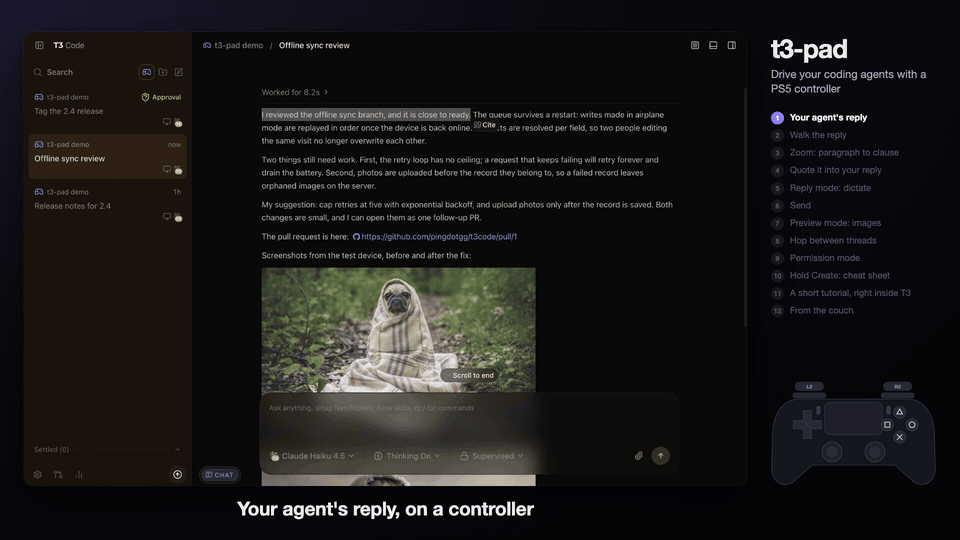

# 🎮 t3-code-pad

**Drive [T3 Code](https://github.com/pingdotgg/t3code) with a PS5 DualSense controller.** Read what your coding agents wrote, pick out a sentence, quote it, dictate your answer and send it, all from the couch. No keyboard, no mouse.

> Unofficial community add-on. Not affiliated with or endorsed by T3 Tools Inc. or Sony.



▶️ **[Watch the 90 s demo](https://petrbrabec.github.io/t3-code-pad/docs/media/t3-code-pad-demo.mp4)** · [en español](https://petrbrabec.github.io/t3-code-pad/docs/media/t3-code-pad-demo.es.mp4)

## ✨ What you can do

- 📖 **Read** an agent's reply sentence by sentence, or zoom out to paragraphs and whole messages.
- 💬 **Quote** any part into your reply with one button (T3's own Cite).
- 🎙️ **Dictate** your answer with [VoiceInk](https://tryvoiceink.com) (hold R2), then **send** with Options.
- ✏️ **Edit your reply**: select, delete, undo, and move the cursor with the touchpad.
- ✅ **Answer permission prompts** and questions from the agent.
- 🖼️ **Browse** links, PRs and images in T3's preview panel.
- 📋 **See every button** any time: hold Create for the cheat sheet, settings and a built-in tutorial.

## 🚀 Quick start

You need macOS, T3 Code desktop 0.1.x, a DualSense, Node.js 22+ and the Xcode command line tools. VoiceInk is optional (only for dictation).

```sh
git clone https://github.com/PetrBrabec/t3-code-pad && cd t3-code-pad
scripts/install.sh
```

1. 🔐 Allow **T3Pad** in System Settings › Privacy & Security › Accessibility (it presses VoiceInk's shortcut for you).
2. 🖥️ Start T3 Code as usual. t3-code-pad restarts it once with a local debugging port.
3. 🎮 Connect the controller and press any button with T3 in front. A small pill appears: **Controller ready**.
4. 📚 Optional: hold **Create** and pick **Start the tutorial** (it needs a practice thread, see [setup](docs/REFERENCE.md#install-in-detail)).

Uninstall with `scripts/install.sh --uninstall`. Optional: `scripts/install.sh --link-target` opens links in T3's own preview panel.

## 🕹️ Buttons

**L2** switches between **chat** (reading) and **reply** (editing your answer). The pill in the bottom left always shows which one you're in.

| | 📖 Chat | ✏️ Reply |
|---|---|---|
| **D-pad ↑ ↓** | previous / next piece | previous / next piece |
| **D-pad ← →** | smaller / bigger piece (clause, sentence, paragraph, message) | same |
| **□ Square** | quote the selection | delete the selection |
| **✕ Cross** | open link or image | |
| **○ Circle** | close preview, clear selection | drop selection, then back to chat |
| **△ Triangle** | jump to latest message | undo |
| **R2 (hold)** | dictate | dictate (replaces the selection) |
| **Options** | send | send |
| **L1 / R1** | previous / next thread | |
| **Touchpad** | click: select a word (again: sentence, paragraph) | slide: move the cursor · click: select a word |
| **Sticks** | left scrolls the chat, right scrolls your reply | same |
| **Create** | tap: command palette · hold: menu | same |

💡 *Square acts on the selection: it quotes in chat and deletes in reply.*

Three more modes switch on when needed: **permission** (L2 while the agent is asking), **palette** (while the command palette is open) and **preview** (while an image or the preview panel is open). Their buttons, the settings and all the details are in the **[reference](docs/REFERENCE.md)**.

## ⚙️ How it works

No fork of T3. A small script is injected into the running app over the Chrome DevTools Protocol, and a tiny macOS helper presses VoiceInk's shortcut. The touchpad is read natively with Apple's GameController framework.

```
DualSense ──Gamepad API──▶ src/t3pad.js (inside T3)
                               │ CDP binding
                               ▼
                    sidecar/sidecar.mjs ──▶ T3Pad.app ──▶ Fn+Space ▶ VoiceInk
```

🔒 The debugging port listens on `127.0.0.1` only, so nothing else on your network can reach it, and it's open only while T3 runs with the flag.

## ⚠️ Limitations

- Built on T3 Code 0.1.x internals, so a T3 update can break it.
- **Options sends on a single press**, into whichever thread is open.
- Each link opened with Cross adds a new preview tab.
- Quoting your *own* messages inserts `> text` (T3 can only cite agent messages).

## 🛠️ Development

Tests drive the live app with a fake controller; see [docs/DEVELOPMENT.md](docs/DEVELOPMENT.md). Developing from another Mac over ssh: copy `.env.example` to `.env.local` and use `scripts/deploy-air.sh`.

## 📄 License

MIT, see [LICENSE](LICENSE). Icons from [Lucide](https://lucide.dev) (ISC), see [THIRD_PARTY_NOTICES.md](THIRD_PARTY_NOTICES.md). PlayStation and DualSense are trademarks of Sony Interactive Entertainment.
